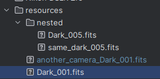
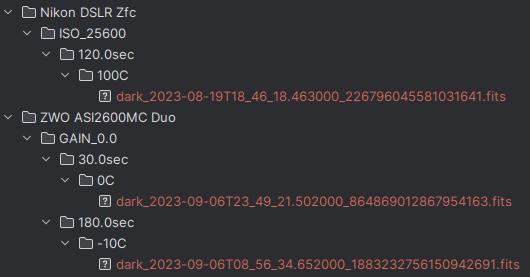
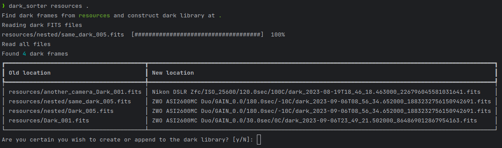
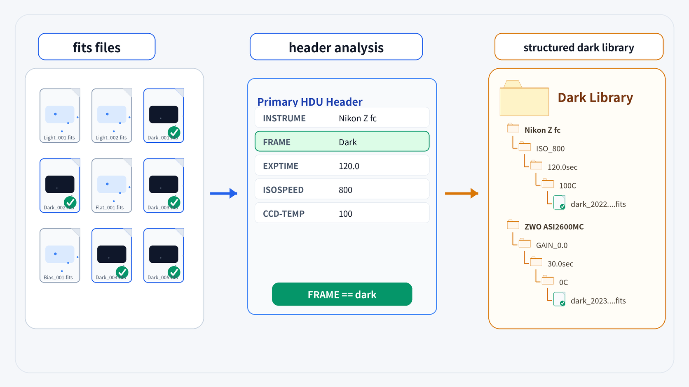
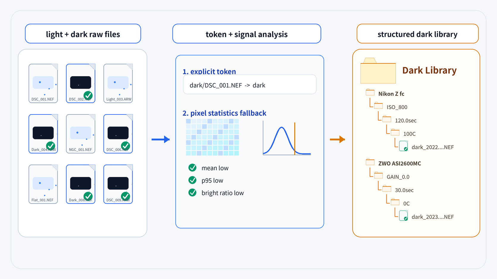

# dark-sorter

Dark Sorter is a Python utility that automatically sorts astrophotography dark frames. It categorizes the dark frames
based on various parameters such as camera model, Gain/ISO settings, temperature, and exposure time. This utility comes
with a Command-Line Interface (CLI) for ease of use.

## Input Example



## Output Library Example



## CLI
The CLI provides a simple interface for batch processing directories.



## Features

* FITS and DSLR RAW Support: Reads FITS files directly and extracts DSLR RAW metadata from common formats such as
  NEF, ARW, CR2, CR3, and DNG. RAW files lacking explicit tokens are validated with low-signal pixel statistics to
  confirm they are dark frames.
* Camera Sorting: Sorts dark frames based on the camera model.
* Gain/ISO Sorting: Categorizes frames based on gain or ISO settings.
* Temperature Sorting: Sorts frames according to temperature conditions, with a precision of 1°C.
* Exposure Time Sorting: Organizes dark frames by their exposure time.
* Duplication Detection: Prevents duplicate frames in the output directory.

## FITS Dark Frame Detection



Dark Sorter evaluates FITS files by analyzing their headers:

* Header analysis: The utility uses Astropy to inspect the primary HDU header of each FITS file.
* Frame selection: Files are filtered to include only those where the `FRAME` header is `dark`.
* Sorting: Detected dark frames are grouped by camera, Gain/ISO, exposure, and temperature.
* Non-dark frames: Files that are not identified as dark frames are ignored.

## RAW Dark Frame Detection



Dark Sorter evaluates RAW files in two passes:

* Explicit frame token: If the file name or closest folders contain `dark`, `bias`, `flat`, or `light`, that token wins.
* Pixel statistics fallback: If no explicit token is found, Dark Sorter decodes the RAW sensor data, normalizes it with
  the camera black/white levels, and treats the file as a dark frame only when the mean signal, 95th percentile signal,
  and bright-pixel ratio are all below conservative thresholds.
* Sorting: Detected dark frames are grouped by camera, Gain/ISO, exposure, and temperature.
* Non-dark frames: Files that are not identified as dark frames are ignored.

## Prerequisites

* Python 3.11 or 3.12
* uv for local development

## Installation

```bash
pip install darksorter
```

## Development

```bash
uv sync --locked
uv run ruff format .
uv run ruff check .
uv run ty check
uv run pytest
```

## Usage

```bash
darksorter <source_directory> <destination_directory>
darksorter ./raw_images ./sorted_darks
```

## CLI Options

```bash
darksorter --help
```

## Contributing

If you wish to contribute to this project, please submit a pull request or open an issue for discussion.

## License

This project is licensed under the MIT License
